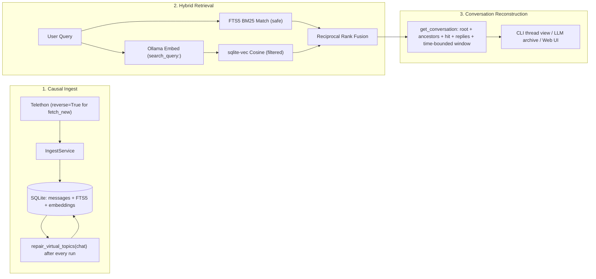

# Architecture, Threading & Hybrid Retrieval Data Flow

## Overview

`tgram` is a local-first Telegram archive, conversation reconstructor, hybrid semantic search engine, and grounded AI Q&A assistant. Everything runs against a single SQLite database (`data/messages.db`) using SQLite WAL mode, FTS5 (`unicode61`), and `sqlite-vec`.



---

## Layered Package Structure

Imports flow strictly downward across layers:

```text
tgram/
├── interfaces/     cli.py, daemon.py, web.py        — CLI arg parsing, background loop, Gradio UI
├── services/       ingest.py, search.py,            — Use-case orchestration (zero raw SQL/network I/O)
│                   ai.py, embed.py
├── adapters/       db.py, telegram.py,              — Centralized DB factory, Telethon with session lock,
│                   repo_messages.py, repo_channels.py, SQLite repos, FTS5 search, sqlite-vec,
│                   repo_topics.py, repo_embeddings.py, Ollama & LiteLLM clients
│                   search_fts.py, llm_ollama.py,
│                   llm_litellm.py
├── domain/         message.py, channel.py,          — Pure frozen dataclasses & pure functions (zero I/O)
│                   topic.py, threading.py
└── migrations/     001_*.sql … 005_*.sql            — Version-gated SQLite schema migrations
```

---

## SQLite Schema (`data/messages.db`)

| Table | Primary Key | Purpose |
|---|---|---|
| `messages` | `(chat_id, id)` | Normalized message fields (`date`, `text`, `from_user_id`, `username`, `reply_to_message_id`, `reply_to_top_message_id`, `virtual_topic_id`, `media_type`) + full Telethon `raw_json`. |
| `channels` | `chat_id` | Tracked dialogs (`title`, `type`, `is_forum`, `last_fetched_id`, `oldest_fetched_id`, `last_fetch_at`, `enabled`). |
| `topics` | `(chat_id, topic_id)` | Forum topic names mapped from Telegram `MessageService` root messages. |
| `messages_fts` | `rowid` (FTS5) | External-content FTS5 table over `messages.text` (`unicode61 remove_diacritics 2`), kept in sync via `AFTER INSERT / UPDATE OF text / DELETE` triggers. |
| `embeddings` | `(chat_id, message_id, chunk_idx)` | Packed 768-dim `float32` vectors (`nomic-embed-text-v2-moe:latest`), queried via `sqlite-vec`'s `vec_distance_cosine()`. |
| `schema_version` | `version` | Migration ledger tracking applied versions 1..5 for 0ms startup overhead. |

---

## Centralized Connection Factory & Concurrency Hardening (`tgram/adapters/db.py`)

All database connections across repositories and search adapters are instantiated through `get_connection()`:
- `PRAGMA journal_mode = WAL;`: Enables concurrent readers alongside a single writer.
- `PRAGMA synchronous = NORMAL;`: Ensures ACID durability while drastically reducing disk sync overhead.
- `PRAGMA busy_timeout = 10000;`: Waits up to 10 seconds on lock contention before raising an error.
- `PRAGMA temp_store = MEMORY;` & `PRAGMA cache_size = -64000;`: Keeps temporary tables in RAM with a dedicated 64 MB page cache.
- **Migration Gating (`ensure_schema`)**: Evaluates `schema_version`. If all migration versions are recorded, skips disk I/O entirely (measured at 2.36 ms).

---

## Telegram Session Concurrency Locking (`tgram/adapters/telegram.py`)

Telethon saves state in `data/sessions/tgram.session` (a SQLite database). If the background daemon is running and a CLI fetch/sync command is invoked concurrently, both processes attempt to open the session file, risking database corruption.
- `TelegramClientAdapter.__aenter__` acquires an advisory file lock (`fcntl.flock(LOCK_EX | LOCK_NB)` on `data/sessions/tgram.lock`).
- If another process holds the lock, it immediately raises `TelegramSessionLockedError`.
- CLI commands intercept this exception and display a clean notice on `stderr` (exit code 1) without traceback noise.
- Releasing the lock (`LOCK_UN`) is guaranteed in `__aexit__`.

## 1. Causal Ingest & Thread Root Resolution (`virtual_topic_id`)

### Telethon Forum vs. Reply Semantics
In Telegram forum supergroups (`is_forum=1`):
- A **top-level post inside a forum topic** has `forum_topic=true`, `reply_to_msg_id=<topic_id>`, and `reply_to_top_id=null`. Normalized in `Message`: `reply_to_message_id == reply_to_top_message_id`.
- A **nested reply to another message inside a forum topic** has `reply_to_msg_id=<parent_msg_id>` and `reply_to_top_id=<topic_id>`.
- A **message in the General topic** (or in a non-forum chat) has `reply_to_top_message_id = NULL`.
- A **cross-chat reply** has `reply_to_peer_id` set; `TelegramClientAdapter._convert()` sets `reply_to_message_id = None` so foreign message IDs never collide with local IDs.

### Single Thread Resolver (`tgram/domain/threading.py`)
Every top-level post (including a top-level post in a forum topic) starts its own conversation thread (`virtual_topic_id = msg.id`), while replies inherit their parent's `virtual_topic_id`:

```python
def is_thread_start(reply_to: int | None, top: int | None) -> bool:
    return reply_to is None or reply_to == top

def resolve_root(
    msg_id: int,
    reply_to: int | None,
    top: int | None,
    known_roots: Mapping[int, int],
) -> int:
    if is_thread_start(reply_to, top):
        return msg_id
    return known_roots.get(reply_to, reply_to)  # orphan -> missing parent's id
```

### Authoritative Per-Chat Repair
1. `IngestService.fetch_new()` streams messages **oldest-first** (`reverse=True`), so `max_id` advances monotonically and an interrupted fetch never leaves a hidden gap.
2. During streaming, `IngestService` deduplicates each 500-message batch with a single `MessageRepo.existing_ids()` query and stamps a best-effort `virtual_topic_id`.
3. At the end of every fetch operation (`fetch_new`, `fetch_old`, `fetch_old_loop`, `fetch_gap`) that saves rows, `MessageRepo.repair_virtual_topics(chat_id)` runs an ordered single-pass scan (`ORDER BY chat_id, id`) and updates any changed `virtual_topic_id` values in one transaction (~0.5s). Late-arriving or backfilled parents automatically re-root their descendants without touching `messages_fts` or `embeddings`.
4. **Autonomous Daemon & Background Auto-Embedding:** In `run_daemon()`, at the end of every polling cycle, `EmbedService.backfill(batch_size=100, max_batches=5, quiet=True)` automatically embeds unembedded messages (up to 500 chunks per 5-minute cycle) in the background. If Ollama is offline or times out, the daemon logs a warning and proceeds without interrupting the polling schedule.

---

## 2. Conversation Reconstruction (`FTSSearch.get_conversation`)

Given any `SearchHit`, `FTSSearch.get_conversation(hit, max_thread_msgs=12, window=2, window_max_gap_min=30)` reconstructs the human conversation around the hit:

1. **Explicit Reply Thread (`virtual_topic_id`):**
   Fetches all messages in `(chat_id, virtual_topic_id)`. If the thread has more than `max_thread_msgs` messages, up to `max_thread_msgs` are selected in strict priority order:
   1. The thread **root** message.
   2. The **hit** message itself (`is_hit=True`).
   3. The hit's **ancestor chain** (`reply_to_message_id` path from the hit back to the root).
   4. The hit's **direct replies** (`reply_to_message_id == hit.message_id`).
   5. Remaining thread messages **closest to the hit by message ID**.
2. **Time-Bounded Temporal Window (`±window` within `window_max_gap_min`):**
   Fetches up to `window` messages immediately before and after `hit.message_id` in the same forum topic (`reply_to_top_message_id = ?`, or `IS NULL` for General / non-forum chats) whose timestamp is within **30 minutes** of the hit. This captures unthreaded follow-up messages posted in the flow of conversation.
3. **Chronological Merge & Gap Indicators:**
   Deduplicates by `id`, sorts chronologically (`ORDER BY id ASC`), and computes `skipped_before` on each `ContextMessage` to show how many intermediate thread messages were omitted (`… N earlier message(s) in thread …`).

---

## 3. Hybrid Search & RRF Fusion

`SearchService.search(query, semantic=True, **filters)` orchestrates retrieval and reports the active mode (`"hybrid"`, `"fts"`, `"fts (operators)"`, or `"fts (ollama unreachable)"`):

1. **Query Sanitization (`_clean_fts_query`):**
   - Strips FTS5 syntax error characters (`( ) + - ^ :` and punctuation).
   - Drops unbalanced `"` quotes.
   - Lowercases bare FTS5 boolean operator tokens (`AND`, `OR`, `NOT`, `NEAR`) so natural-language queries like `"not working"` or `"near Wroclaw"` never trigger `sqlite3.OperationalError`.
   - Wraps FTS `MATCH` execution in `try/except sqlite3.OperationalError` so vector results still return even if FTS rejects an edge-case query.
2. **Filtered Vector Search (`EmbeddingRepo.search_similar`):**
   - Embeds the query with `"search_query: "` via `OllamaAdapter.embed()` (5s fast-fail timeout).
   - Applies `chat_id`, `topic_id`, `since`, and `until` predicates before grouping by `(chat_id, message_id)` and sorting by `MIN(vec_distance_cosine(vector, ?))`.
3. **Reciprocal Rank Fusion (`_rrf_merge`):**
   - Combines FTS5 BM25 ranks and vector cosine distance ranks using $\text{score}(d) = \sum \frac{1}{k + \text{rank}(d)}$ with $k = 60$.

---

## 4. Thread-Aware AI Q&A & Citation Indexing (`AIService`)

1. **Per-Adapter Context Budgets:**
   - `OllamaAdapter`: `context_chars = 12_000` with `options={"num_ctx": 12288}` and top-level `think=think`.
   - `LiteLLMAdapter`: `context_chars = 24_000`.
2. **Deduplicated Thread Blocks (`_build_context`):**
   - Iterates ranked `SearchHit`s, skipping any hit whose `(chat_id, virtual_topic_id)` has already been included.
   - Expands each unique thread via `fts.get_conversation(hit, max_thread_msgs=10, window=1)`.
   - Renders chronological blocks with header `--- [topic] YYYY-MM-DD ---`, `[msg:N] HH:MM @user: text`, and `↳ [reply to msg:M]` markers until the adapter's `context_chars` budget is reached.
   - Returns `(context_str, context_index)` where `context_index: dict[int, tuple[int, int]]` maps every included `message_id` (including expanded replies and ancestors) to `(chat_id, message_id)` so clickable `[↗ msg:N]` badges in the Gradio UI always resolve accurately across multi-chat archives.
