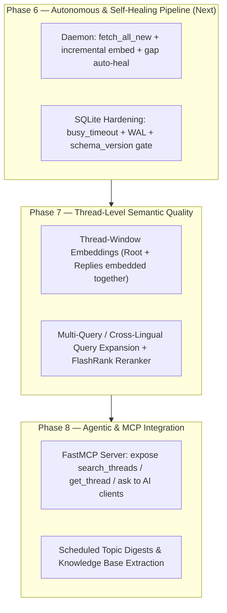

# `tgram` Development Strategy — Roadmap, Enhancements, Ready-to-Use Replacements & Stability

## Current Baseline (Post-Phase 5)

| Component | Current Implementation | Scale / Performance |
|---|---|---|
| **Storage** | SQLite (`data/messages.db`, 3.5 GB) with WAL, FTS5 (`unicode61`), `sqlite-vec` | **321,359** messages, **290,801** vector chunks |
| **Threading** | Causal ingest (`reverse=True`) + single-pass `repair_virtual_topics` (`tgram/domain/threading.py`) | **165,050** threads across 3 chats, **0** broken reply chains |
| **Retrieval** | Hybrid FTS5 BM25 + `sqlite-vec` cosine merged via RRF (`k=60`) + `get_conversation` | **~0.60s** internal query latency |
| **AI Q&A** | Thread-grouped `<archive>` blocks + `context_index` citations via `OllamaAdapter` / `LiteLLMAdapter` | 12k chars (`num_ctx=12288`) local / 24k chars cloud |



---

## 1. What Next? (Phased Development Strategy)

### Phase 6 — Zero-Touch Autonomous Operation (Short Term, 1–2 days)
Right now, `tgram/interfaces/daemon.py` only runs `fetch_all_new` and `refresh_dialogs`. Embeddings (`make embed`) still require manual runs, and startup migrations re-run on every command.
- **Auto-Embed in Daemon:** At the end of each `fetch_all_new` cycle in `daemon.py`, if `total > 0` (or `repo_embed.count_missing() > 0`), run `EmbedService.backfill(batch_size=100)` for a bounded number of batches so new messages become semantically searchable within 5 minutes of arrival.
- **Skip Startup Migration Re-Execution:** `MessageRepo._apply_schema()` and `EmbeddingRepo._apply_schema()` currently re-execute all 5 `.sql` files on every instantiation. Gate migration execution behind `SELECT MAX(version) FROM schema_version` so startup is instant and write-free.
- **macOS `launchd` / Docker Compose Production Service:** Add a `launchd` plist (or update `docker-compose.yml` to mount `./data/sessions`) so the daemon + web UI run continuously in the background.

### Phase 7 — Conversation-Level Embeddings & Reranking (Medium Term, 2–4 days)
Currently, each message is embedded in isolation (`tgram/services/embed.py`), and threads are reconstructed *after* retrieval.
- **Contextual / Thread-Prefix Embeddings:** A short reply like *"Так, у Вроцлаві на Примаса приймають без черги"* doesn't mention *what* is accepted without a queue (e.g., *"карта побиту"* or *"PESEL"*), which was in the thread's root message. Prepending `[Topic: <topic_title>] [Thread root: <root_text[:150]>]` before embedding each reply dramatically improves vector recall for short answers.
- **Lightweight Local Cross-Encoder Reranking:** RRF (`_rrf_merge`) merges ranks blindly without reading the query+thread pair together. Adding a tiny CPU cross-encoder reranker (`FlashRank` or `bge-reranker-v2-m3` via Ollama) over the top 25 candidate threads before feeding the top 10 to the LLM eliminates noisy keyword hits.
- **Multi-turn Query Rewriting in `AIService`:** In `AIService.ask_with_history()`, retrieval currently searches only the raw follow-up `question`. If the user asks *"А скільки це коштує?"* on turn 2, FTS and vector search only see *"А скільки це коштує?"*. Rewriting follow-up questions into standalone search queries using the prior turn fixes multi-turn retrieval.

### Phase 8 — MCP Server & Knowledge Extraction (Longer Term)
- **Expose `tgram` as an MCP Server (`FastMCP`):** A 60-line `tgram/interfaces/mcp_server.py` exposing `search_conversations(query, chat_id, topic_id, since)`, `get_thread(message_id, chat_id)`, and `list_topics(chat_id)` lets Claude Desktop, Cursor, or Antigravity query your Telegram archive directly as a tool without switching to the Gradio UI.
- **Topic Wiki / FAQ Distillation:** Forum topics like *"JDG / ФОП"* or *"Карта побиту"* accumulate thousands of repetitive Q&As. A scheduled job can synthesize canonical FAQ pages per topic with `[msg:ID]` citations and change-tracking ("what changed in 2026 vs 2025").

---

## 2. What Can Be Enhanced in the Existing Codebase?

1. **Multi-Turn Follow-up Retrieval (`tgram/services/ai.py`):**
   - **Problem:** On turn 2+, `ask_with_history` embeds and searches `question` alone (`"What documents are needed for it?"`), losing the entity from turn 1 (`"Blue Card"`).
   - **Enhancement:** When `history` is non-empty, combine the last user question keywords (or run a fast LLM query-condense step) before calling `self.fts.search()`.

2. **Morphological / Stemming Support for Ukrainian, Polish & Russian (`003_fts5.sql`):**
   - **Problem:** `tokenize='unicode61 remove_diacritics 2'` does exact token matching without Slavic inflection stemming (`"податки"` ≠ `"податків"` ≠ `"податкова"`).
   - **Enhancement:** While hybrid vector search partially bridges this gap, FTS5 `trigram` tokenizer or lemmatization/prefix expansion on query terms (`податк*`) improves keyword recall when Ollama is offline or for rare proper nouns.

3. **Message Edits & Useful Media Metadata (`tgram/adapters/telegram.py`):**
   - **Problem:** `_convert()` extracts `tlm.message` and `type(tlm.media).__name__`, ignoring webpage link previews (`MessageMediaWebPage` title/description/URL), poll questions/options (`MessageMediaPoll`), and document filenames (`MessageMediaDocument`). Many high-value Telegram replies are just a shared link or PDF form!
   - **Enhancement:** Append webpage preview titles/URLs, document filenames, and poll text to `Message.text` (or a dedicated indexed column) during `_convert()` — and backfill them from the already-stored `raw_json` in SQLite without re-fetching from Telegram!

4. **Recency & Engagement Signals in Ranking (`tgram/adapters/search_fts.py`):**
   - **Problem:** Tax laws, legalization rules, and prices change yearly. A 2023 message and a 2026 message with similar text score identically in `_rrf_merge`, and `raw_json` already stores `reactions` and `replies` counts that go unused.
   - **Enhancement:** Add a slight time-decay boost (e.g., favoring newer messages) and reaction/reply-count weight into `_rrf_merge` so recent, community-validated answers rank above outdated ones.

---

## 3. What Can Be Replaced with Ready-to-Use Implementations?

You do **not** need to replace your core architecture (SQLite + Telethon is already an ideal local-first design), but several hand-rolled plumbing pieces can be swapped for battle-tested libraries:

| Area | Current Custom Code | Ready-to-Use Replacement | Verdict / Recommendation |
|---|---|---|---|
| **Vector Index & Hybrid Search** | `repo_embeddings.py` (`sqlite-vec` brute-force table scan over 290k BLOBs) + custom `_rrf_merge` | **LanceDB** (embedded, serverless on-disk IVF-PQ/HNSW + native Tantivy FTS + built-in RRF & rerankers) **OR** `sqlite-vec` `vec0` virtual table | **Keep `sqlite-vec` up to ~500k chunks** (0.6s is fast enough). If archive grows past 1M chunks or you want <50ms filtered ANN + built-in reranking without a server, **LanceDB** (`pip install lancedb`) is a drop-in single-folder replacement. |
| **Text Chunking** | `embed.py` (`_chunk_text` splits mid-word/mid-sentence every 400 chars) | **`semchunk`** or **`chonkie`** (ultra-fast, zero-dependency token/sentence-aware chunkers) | **Replace.** `_chunk_text` currently slices strings at fixed character indices (`text[start:start+400]`), cutting Cyrillic words and URLs in half. A sentence/word-boundary splitter takes 10 lines or `semchunk`. |
| **Reranking** | None (raw RRF rank order in `search_fts.py`) | **`flashrank`** (4MB ONNX cross-encoder, runs on CPU in ~30ms) or LiteLLM rerank | **Add `flashrank`.** Zero external server needed, drastically improves top-5 conversation precision before LLM synthesis. |
| **CLI Boilerplate** | `cli.py` (manual `argparse` + `print` formatting) | **`typer` + `rich`** | **Optional.** `rich` tables/trees make `thread` and `search --context` output much easier to scan in the terminal. |
| **Config & Env Validation** | `config.py` + scattered `os.getenv()` in `daemon.py`, `Makefile` | **`pydantic-settings`** | **Recommended.** Centralizes all env vars (`FETCH_INTERVAL_MINUTES`, `OLLAMA_HOST`, `CHAT_MODEL`, API keys) with validation in one `Config` class. |
| **Resilience / Retries** | Manual `try/except` in `embed.py` and `daemon.py` | **`tenacity`** | **Recommended** for Ollama/LiteLLM network calls and transient SQLite lock retries. |
| **AI Client Access** | Custom Gradio UI (`web.py`) | **`mcp` (`FastMCP`)** alongside Gradio | **Add `FastMCP`.** Lets any MCP-capable assistant query your archive natively. |

---

## 4. How to Make It Work Efficiently and Stably?

### 4.1 SQLite Concurrency & Connection Hardening (High Priority)
Right now, every repository method opens a bare `sqlite3.connect(self.db_path)` with default settings (`timeout=5.0`, `journal_mode` only set in `EmbeddingRepo`, no `busy_timeout` or `synchronous` pragma on new connections).
- **Create a single shared connection factory `tgram/adapters/db.py`:**
  Every connection across `MessageRepo`, `TopicRepo`, `ChannelRepo`, `FTSSearch`, and `EmbeddingRepo` should configure:
  ```sql
  PRAGMA journal_mode = WAL;
  PRAGMA synchronous = NORMAL;
  PRAGMA busy_timeout = 10000;
  PRAGMA temp_store = MEMORY;
  PRAGMA cache_size = -64000; -- 64 MB page cache
  ```
- **Run Migrations Once at Startup:**
  Check `SELECT MAX(version) FROM schema_version` and only run migration scripts with a higher version number.

### 4.2 Vector Search Efficiency (`sqlite-vec`)
- **How to speed up `search_similar` 3–5× without changing databases:**
  1. **Composite Index for Filtered Joins:** Add `CREATE INDEX IF NOT EXISTS idx_messages_chat_topic_date ON messages(chat_id, reply_to_top_message_id, date, id);` so `--topic` and `--since` filters narrow candidate `message_id`s via an index-only scan before touching the 290k vector BLOBs.
  2. **Int8 Quantization (`vec_quantize_i8`) or `vec0` Virtual Table:** `nomic-embed-text-v2-moe` supports Matryoshka dimensions (e.g., 256 or 512 dims instead of 768) and `sqlite-vec` supports `int8` vectors, cutting vector I/O bandwidth by **4×–6×** with <1% recall loss.
  3. **Reuse Persistent DB + Ollama Connections in `web.py` and `daemon.py`:** Keep a persistent read connection (or thread-local connection) with `sqlite_vec` already loaded.

### 4.3 Telethon Session Stability
- **SQLite Session Locking:** Telethon stores its auth state in `data/sessions/tgram.session` (which is itself a SQLite file). If `make daemon` is running and you run `make fetch-new` or `make sync-topics` in another terminal, both processes open `tgram.session` concurrently and can raise `sqlite3.OperationalError: database is locked`.
- **Fix:** Add an advisory file lock (`fcntl.flock` on `data/sessions/tgram.lock`) inside `TelegramClientAdapter.__aenter__` with a clear message (`"Another tgram process (e.g. daemon) is currently connected to Telegram"`), and handle `FloodWaitError` inside `fetch_all_new` with `await asyncio.sleep(e.seconds + 1)`.
