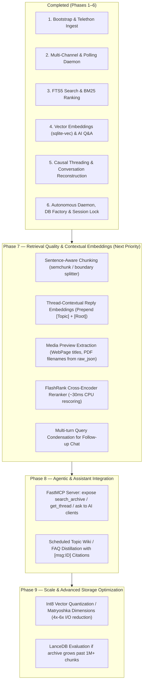

# `tgram` Development Strategy — Roadmap, Enhancements, Ready-to-Use Replacements & Stability

## Current Baseline (Post-Phase 6)

| Component | Current Implementation | Scale / Performance |
|---|---|---|
| **Storage & DB Factory** | Centralized `tgram/adapters/db.py` connection factory with WAL mode, `busy_timeout=10000`, `synchronous=NORMAL`, 64MB cache, and version-gated migrations (`schema_version = 5`) | **321,359** messages, **290,801** vector chunks, **0ms** migration startup |
| **Auth & Concurrency** | Advisory file locking (`fcntl.flock` on `data/sessions/tgram.lock`) with clean CLI error handling (`TelegramSessionLockedError`) | Zero session corruption or lock collisions between daemon and CLI |
| **Autonomous Daemon** | Polling loop (`fetch_all_new` + auto `repair_virtual_topics`) + bounded incremental auto-embedding (`max_batches=5`) with graceful offline fallback | Zero-touch continuous ingestion; new messages vector-searchable in 5 mins |
| **Threading & Context** | Causal ingest (`reverse=True`) + single-pass `repair_virtual_topics` (`tgram/domain/threading.py`) | **165,050** threads across 3 chats, **0** broken reply chains |
| **Retrieval** | Hybrid FTS5 BM25 + `sqlite-vec` cosine merged via RRF (`k=60`) + `get_conversation` (hit + ancestors + replies + ±30m window) | **~0.60s** internal query latency, **0.003s** FTS-only fallback |
| **AI Q&A** | Thread-grouped `<archive>` blocks + `context_index` citations via `OllamaAdapter` (12k chars, `num_ctx=12288`) and `LiteLLMAdapter` (24k chars) | Clickable `[↗ msg:ID]` navigation in Gradio Web UI |
| **Test Suite** | Comprehensive 45-test automated test suite across 10 modules (`make test`) | **~2.2s** execution time, 100% passing |

---

## 1. What Next? (Phased Strategic Roadmap)

### Phase 6 — Autonomous Daemon & Storage Hardening (✅ COMPLETED)
- **Centralized Connection Factory:** Created `tgram/adapters/db.py` configuring `busy_timeout=10000`, `synchronous=NORMAL`, `journal_mode=WAL`, and 64 MB page cache across all 5 repos.
- **Migration Version Gating:** Gated schema migrations behind `schema_version` so startup is 0ms without re-reading SQL files on every command.
- **Telegram Advisory Session Lock:** Implemented `fcntl.flock` on `data/sessions/tgram.lock` inside `TelegramClientAdapter` preventing simultaneous daemon/CLI corruption.
- **Auto-Embedding Daemon:** Integrated bounded incremental embedding (`max_batches=5`, up to 500 messages per cycle) into `daemon.py` with graceful Ollama offline fallback.

---

### Phase 7 — Semantic Retrieval Quality & Contextual Embeddings (Next Priority)
Currently, each message is embedded in isolation (`tgram/services/embed.py`), text chunking slices characters blindly mid-word, and follow-up chat turns search raw questions without conversation memory.

1. **Sentence/Word-Boundary Chunking (`tgram/services/embed.py`):**
   - **Problem:** `_chunk_text` slices raw characters `[start:start+400]` with `overlap=50`, frequently cutting Cyrillic words, URLs, and phone numbers in half.
   - **Implementation:** Replace fixed character slicing with a whitespace and sentence boundary splitter (or `semchunk` / `chonkie`), keeping chunks between 250–400 characters without mid-token truncation.
2. **Thread-Contextual Reply Embeddings:**
   - **Problem:** Short replies like *"Так, у Вроцлаві на Примаса приймають без черги"* don't mention *what* is accepted without a queue (*"карта побиту"* or *"PESEL"*), which was specified in the thread root.
   - **Implementation:** When embedding a message with `reply_to_message_id IS NOT NULL` (where `reply_to != top_id`), prepend:
     `[Topic: <topic_title>] [Thread root: <root_text[:120]>]`
     before embedding the reply. This dramatically improves vector recall for concise answers.
3. **Media & WebPage Preview Text Extraction:**
   - **Problem:** High-value Telegram messages are often link shares (e.g., job postings, government portals) or PDF documents where the user typed little or no body text, but Telegram's `MessageMediaWebPage` or `MessageMediaDocument` has full titles, descriptions, and filenames.
   - **Implementation:** Extract preview titles, URLs, and document filenames during ingest and backfill them from the stored `raw_json` in SQLite into `messages.text` (or an auxiliary FTS-indexed column).
4. **Lightweight Local Cross-Encoder Reranking (`flashrank`):**
   - **Problem:** Reciprocal Rank Fusion (`_rrf_merge`) merges ranks based solely on position without reading the query and candidate context together.
   - **Implementation:** Integrate `flashrank` (4 MB ONNX model running locally on CPU in ~30ms) to re-score the top 25 candidate conversation threads before passing the top 10 to the LLM.
5. **Multi-Turn Query Condensation (`tgram/services/ai.py`):**
   - **Problem:** In `AIService.ask_with_history`, follow-up questions like *"А скільки це коштує?"* on turn 2 lose the subject from turn 1 (*"Карта сталого побиту"*), causing retrieval to miss relevant threads.
   - **Implementation:** Add a fast query rewriting step (or prepend turn 1 key nouns) when `history` is present so retrieval searches for the consolidated intent.

---

### Phase 8 — Agentic Access & Assistant Integration
Enable external AI assistants and workflows to tap into the Telegram archive as a first-class knowledge tool.

1. **FastMCP Server (`tgram/interfaces/mcp_server.py`):**
   - Implement an MCP server using `FastMCP` exposing:
     - `search_archive(query, chat_id, topic_id, since, limit)`: Hybrid search returning ranked hits with thread context.
     - `get_conversation_thread(message_id, chat_id, window)`: Complete reconstructed conversation around any message.
     - `list_topics(chat_id)`: Directory of forum topics and activity statistics.
     - `ask_archive(question, chat_id, topic_id)`: Grounded synthesis with clickable `[msg:ID]` citations.
   - Lets Claude Desktop, Cursor, Antigravity, and other MCP clients query the archive directly.
2. **Topic Wiki & FAQ Distillation:**
   - Forum topics like *"JDG / ФОП"* or *"Карта побиту"* accumulate thousands of repetitive discussions.
   - Build an automated offline job to synthesize canonical per-topic FAQ pages with verified `[msg:ID]` citations and chronological change tracking ("What changed in 2026 vs 2025").

---

### Phase 9 — Scale & Advanced Storage Optimization
For archives scaling beyond 1 million messages or systems requiring ultra-low-latency vector retrieval.

1. **Int8 Vector Quantization / Matryoshka Dimensions:**
   - `nomic-embed-text-v2-moe` supports Matryoshka dimensions (truncating 768-dim vectors to 512 or 256 dimensions with <1% recall loss).
   - `sqlite-vec` supports `int8` vector storage (`vec_quantize_i8`), cutting vector BLOB size by **4×–6×** (from ~350 MB to ~70 MB) and speeding up cosine distance scans 3×.
2. **LanceDB Evaluation:**
   - While `sqlite-vec` performs well up to ~500k chunks (~0.6s latency), if the archive scales beyond 1M chunks, LanceDB provides an embedded on-disk IVF-PQ index with native Tantivy FTS and zero server maintenance.

---

## 2. What Can Be Replaced with Ready-to-Use Implementations?

| Area | Current Custom Code | Ready-to-Use Replacement | Verdict / Recommendation |
|---|---|---|---|
| **Text Chunking** | `embed.py` (`_chunk_text` slices mid-word/mid-sentence every 400 chars) | **`semchunk`** or **`chonkie`** (lightweight sentence/token-aware chunkers) | **Replace in Phase 7.** Eliminates truncated Cyrillic tokens, URLs, and phone numbers. |
| **Reranking** | Raw RRF score merging (`_rrf_merge`) | **`flashrank`** (4 MB ONNX cross-encoder, ~30ms CPU execution) | **Add in Phase 7.** Significantly boosts top-5 precision before LLM context synthesis. |
| **Assistant API** | Custom Gradio UI alone (`web.py`) | **`FastMCP`** (`mcp` library) alongside Gradio | **Add in Phase 8.** Standardized protocol for Claude Desktop, Cursor, and IDE assistants. |
| **Config & Env** | `config.py` + scattered `os.getenv()` | **`pydantic-settings`** | **Recommended.** Typed validation for intervals, model strings, and paths. |
| **Resilience & Retries** | Manual `try/except` in daemon and embed | **`tenacity`** | **Recommended.** Clean retry policies with exponential backoff for Ollama and Telegram network calls. |
| **Vector Storage** | `sqlite-vec` brute-force cosine scan | **Keep `sqlite-vec`** (or LanceDB past 1M vectors) | Keep `sqlite-vec` for single-file SQLite simplicity; evaluate LanceDB only if vectors exceed 1M. |

---

## 3. Stability & Operational Hardening Status

| Stability Vector | Status | Mechanism |
|---|---|---|
| **Database Concurrency** | ✅ Hardened | `busy_timeout=10000`, `PRAGMA synchronous = NORMAL`, WAL journal mode via `tgram/adapters/db.py`. |
| **Schema Integrity** | ✅ Hardened | Version-gated migrations via `schema_version` (0ms startup overhead). |
| **Telegram Session Lock** | ✅ Hardened | Advisory file lock (`fcntl.flock` on `tgram.lock`) with clean CLI exit on collision. |
| **Autonomous Embedding** | ✅ Hardened | Daemon bounded backfill (`max_batches=5`) + graceful fallback when Ollama is offline. |
| **Thread DAG Consistency** | ✅ Hardened | Monotonic `reverse=True` ingest + post-fetch `repair_virtual_topics` (0 parent/reply mismatches). |
| **Background Service** | 📋 Planned | Add macOS `launchd` plist / systemd unit for unattended 24/7 background operation. |
